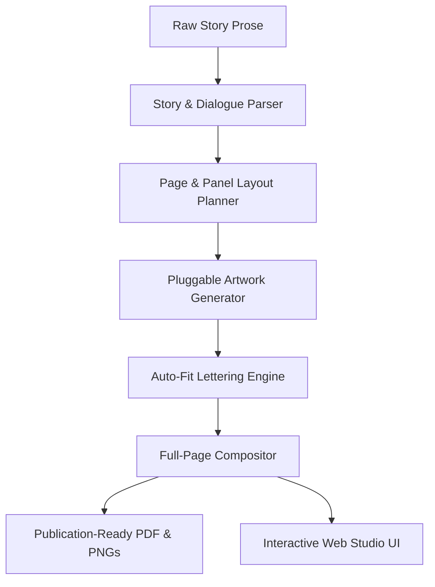

# PanelForge ⚡

An autonomous, end-to-end engine that transforms raw text stories into publication-ready manga and graphic novel pages with intelligent panel layouts, character staging, procedural screentone visuals, auto-fitted speech bubble lettering, and multi-page PDF compilation.

Developed from scratch by **Yahya Ali Khan** (`@yxhyxalikhan-dev`).

---

## 🌟 Key Highlights

- **🧠 Prose-to-Screenplay Parsing:** Intelligently extracts narrative pacing, detects characters, identifies dialogue vs narration, and plans cinematic camera angles (wide, close-up, dramatic, medium).
- **📐 Dynamic Panel Layouts:** Mathematical grid engine featuring 1-panel full splashes, 2-panel vertical stacks, 3-panel classic arrangements, 4-panel balanced grids, and dynamic 5-panel sequences.
- **🎨 Pluggable Visual Backends:**
  - **Procedural Line-Art & Screentone Engine:** Built-in offline generator creating authentic manga screentones, cross-hatching, action speed-lines, and silhouette character staging with **zero API costs**.
  - **Diffusion API Connector:** Seamless integration interface for external models (Stable Diffusion, DALL-E, Flux) when API keys are configured.
- **💬 Auto-Fit Speech Balloon Lettering:** Computes word-wrapping, multi-line scaling, tail pointers, dialogue tags, and specialized shapes (speech balloons, shout spikes, thought clouds).
- **📄 High-Fidelity Export:** Instant multi-page high-resolution PNG rendering and print-ready A4 PDF compilation via ReportLab.
- **🌐 Interactive Web Studio + CLI:** Run via quick command-line flags or launch the modern FastAPI web interface.

---

## 🏗️ Architecture



---

## 🚀 Quick Start

### 1. Installation
Clone the repository and install dependencies:
```bash
git clone https://github.com/yxhyxalikhan-dev/PanelForge.git
cd PanelForge
pip install -r requirements.txt
```

### 2. Run the Demo
Generate sample manga pages and a PDF from the built-in sample story:
```bash
python3 -m panelforge demo
```
Outputs will be saved in `output/`:
- `output/page_01.png`, `output/page_02.png`, `output/page_03.png`
- `output/a_hunter's_dawn.pdf`
- `output/project_state.json`

### 3. Generate from Your Own Story
```bash
python3 -m panelforge run my_story.txt --style classic_bw --title "My Manga"
```
Flags:
- `--style`: `classic_bw` (traditional manga) or `modern_color` (webtoon palette).
- `--output`: Custom output directory (default: `output`).
- `--api`: Enable external Diffusion API image generation if `.env` keys exist.

### 4. Launch the Interactive Web Studio
```bash
python3 -m panelforge web
```
Open [http://127.0.0.1:8000](http://127.0.0.1:8000) in your browser to write scripts, customize layouts, and view pages in real-time.

---

## 🧪 Running Unit Tests

Automated test suite covering text parsing, panel layout calculations, speech bubble fitting, and PDF generation:
```bash
pytest tests/ -v
```

---

## 📦 Project Structure

```
PanelForge/
├── panelforge/
│   ├── core/          # Data models, story & dialogue parser
│   ├── layout/        # Panel layout geometry & template system
│   ├── generators/    # Procedural screentone & API visual generators
│   ├── lettering/     # Speech bubble engine with auto-text fitting
│   ├── export/        # Page compositor & ReportLab PDF compiler
│   ├── web/           # FastAPI web studio & dashboard
│   ├── cli.py         # Command-line entry points
│   └── __main__.py    # Module runner
├── tests/             # PyTest test suite
├── examples/          # Sample story prose
├── output/            # Rendered PNG pages, state JSON, and final PDF
│   └── linkedin/      # Showcase graphics & post copy
├── LICENSE            # MIT License
├── requirements.txt   # Dependencies
└── README.md          # Documentation
```

---

## 📄 License & Attribution

Designed and built by **Yahya Ali Khan**.  
Released under the [MIT License](LICENSE).
